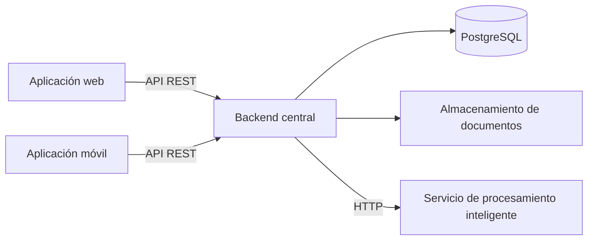

# 3CodersTeam

## Ágora · Plataforma Integral para Complejo Deportivo Municipal

Desarrollamos una plataforma para digitalizar y centralizar la gestión del **Complejo Deportivo Municipal de Durazno, Uruguay**, como parte del **Proyecto Final de la Licenciatura en Tecnologías de la Información de UTEC**.

Nuestro objetivo es facilitar el acceso de la comunidad a las propuestas deportivas y brindar al personal del Complejo herramientas para organizar sus actividades y procesos administrativos.

## El proyecto

Ágora reúne una aplicación web, una aplicación móvil, un backend central y un servicio de procesamiento inteligente, junto con la infraestructura necesaria para su despliegue.

El alcance de la solución contempla:

- **Usuarios y permisos:** registro, autenticación y acceso según las responsabilidades de cada usuario.
- **Actividades y espacios:** organización de propuestas deportivas, turnos, cupos e inscripciones.
- **Documentación:** presentación, revisión y seguimiento de los documentos requeridos.
- **Pagos y pases:** gestión de planes y condiciones de acceso a las actividades.
- **Asistencia y acceso:** registro de asistencia y validación del ingreso al Complejo.
- **Comunicaciones:** avisos y notificaciones para acompañar la participación de los usuarios.
- **Procesamiento inteligente:** extracción de información de documentos mediante OCR, verificación facial y recomendaciones personalizadas.

**El proyecto se encuentra en desarrollo.** Las funcionalidades se incorporan de forma incremental; el alcance descrito no implica que todas estén disponibles. Cada repositorio documenta su estado, configuración y forma de ejecución.

## Repositorios

| Repositorio | Propósito | Tecnologías principales |
| --- | --- | --- |
| [backend](https://github.com/3CodersTeam/backend) | API REST central, reglas de negocio, seguridad y persistencia, con arquitectura de monolito modular. | Java 21, Spring Boot, PostgreSQL, Flyway |
| [frontend-web](https://github.com/3CodersTeam/frontend-web) | Aplicación web para usuarios, personal y administradores del Complejo. | Next.js, React, TypeScript, Tailwind CSS |
| [frontend_mobile](https://github.com/3CodersTeam/frontend_mobile) | Aplicación móvil orientada a los usuarios externos. | Flutter, Dart, Riverpod, Dio |
| [intelligent-processing-service](https://github.com/3CodersTeam/intelligent-processing-service) | Servicio especializado para OCR, verificación facial y recomendaciones. | Python, FastAPI, PaddleOCR, OpenCV, InsightFace, Scikit-learn |
| [infra](https://github.com/3CodersTeam/infra) | Infraestructura como código y flujos de despliegue en Google Cloud. | Terraform, Cloud Run, Cloud SQL, Cloud Storage, GitHub Actions |
| [.github](https://github.com/3CodersTeam/.github) | Repositorio del perfil y presentación de la organización en GitHub. | Markdown |
| [demo-repository](https://github.com/3CodersTeam/demo-repository) | Repositorio de demostración de funcionalidades de GitHub. | — |

El acceso a los repositorios privados requiere permisos en la organización.

## Cómo se integra la plataforma

El backend centraliza las reglas de negocio y coordina el acceso a los datos y a los servicios auxiliares. El servicio inteligente encapsula el procesamiento especializado y se comunica con el backend mediante contratos HTTP.

El despliegue previsto se administra desde `infra` con Terraform sobre Google Cloud. Las aplicaciones mantienen su código y la construcción de sus imágenes en sus respectivos repositorios.

## Desarrollo y colaboración

Para trabajar en un componente, consultá su `README.md` y las guías de desarrollo y contribución disponibles en el repositorio. Allí se detallan los requisitos, las variables de entorno, los comandos y las verificaciones correspondientes.

Los cambios se revisan mediante pull requests y se validan con los controles de calidad de cada componente. Las decisiones técnicas y los contratos de integración se documentan junto al código.

## Equipo

| Integrante | Contacto |
| --- | --- |
| Avril Peraza | [avril.peraza@estudiantes.utec.edu.uy](mailto:avril.peraza@estudiantes.utec.edu.uy) |
| Felipe Hernández | [felipe.hernandez@estudiantes.utec.edu.uy](mailto:felipe.hernandez@estudiantes.utec.edu.uy) |
| Lucas Areosa | [lucas.areosa@estudiantes.utec.edu.uy](mailto:lucas.areosa@estudiantes.utec.edu.uy) |

**3CodersTeam · UTEC · Uruguay**
